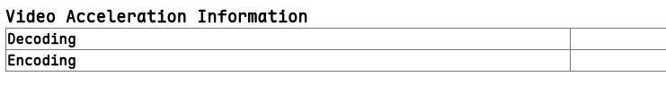
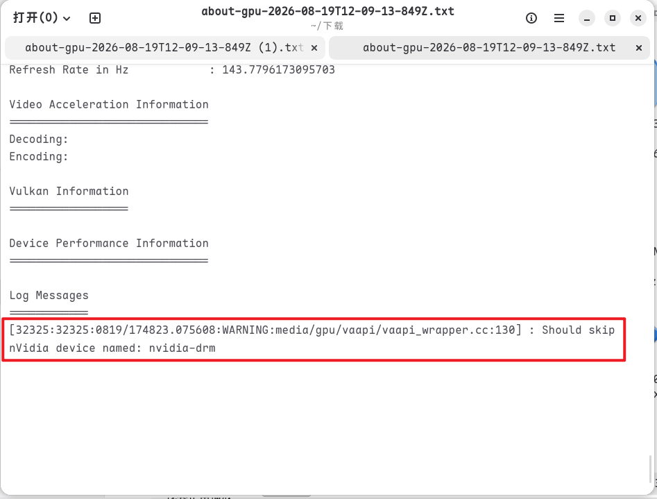
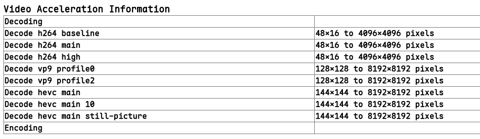
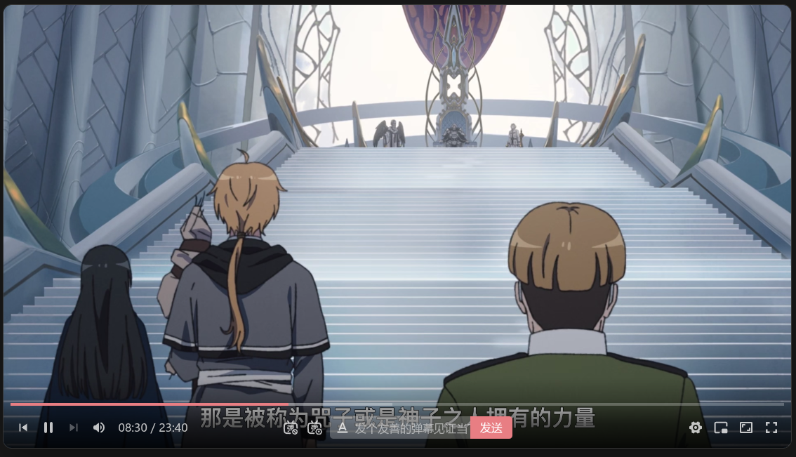

## 前因
之前用Windows时，一直在某网站看动漫。都是点开及播放。
现在装了Fedora（第一次用Linux系统），安装chrome浏览器打开同样的网站会提示当前浏览器不支持HLS。
我就起了怪了，之前在Windows上都可以直接看。
bing了一下，好像是Fedora因阿美拉卡版权问题装的是残疾版的ffmpeg，需要装以下完整版的

### 安装完整的ffmpeg,解决黑屏有声音没画面
```bash
sudo dnf4 group install multimedia
sudo dnf swap 'ffmpeg-free' 'ffmpeg' --allowerasing # Switch to full FFMPEG.
sudo dnf update @multimedia --setopt="install_weak_deps=False" --exclude=PackageKit-gstreamer-plugin # Installs gstreamer components. Required if you use Gnome Videos and other dependent applications.
sudo dnf group install -y sound-and-video # Installs useful Sound and Video complementary packages.
```

但安装后 还是提示不支持的HLS，


在浏览器打开```chrome://gpu```,搜索**Video Acceleration Information**，会看到Decoding那栏是空的

导出整个日志，发现日志最后一段,Chrome明明识别到了nvidia-drm却跳过了

所以在终端添加启动项运行Chrome
```bash
google-chrome --enable-features=VaapiOnNvidiaGPUs
```
再回看```chrome://gpu```，Decoding已经显示出可以解码的格式了


在回到视频网站就不会再提示 当前浏览器不支持该HLS视频编码，就可以愉快的看卡通片了📨


### 添加启动项
为桌面图标添加启动项，不用每次都要在终端启动
```bash
    #在所有(3个)的EXEC后添加--enable-features=VaapiOnNvidiaGPUs
    sudo nano /usr/share/applications/google-chrome.desktop
```

## 后果
三天终于找到解决办法了，问Ai老是沙笔笔的来来回回让我给他看显卡驱动，chrome://gpu和chrome://media-internals😮‍💨
中文网上都搜不到相关内容😡，英文全是141版本前Chrome还没默认支持HLS的帖😫

**希望能帮到你🥹**😀😋


